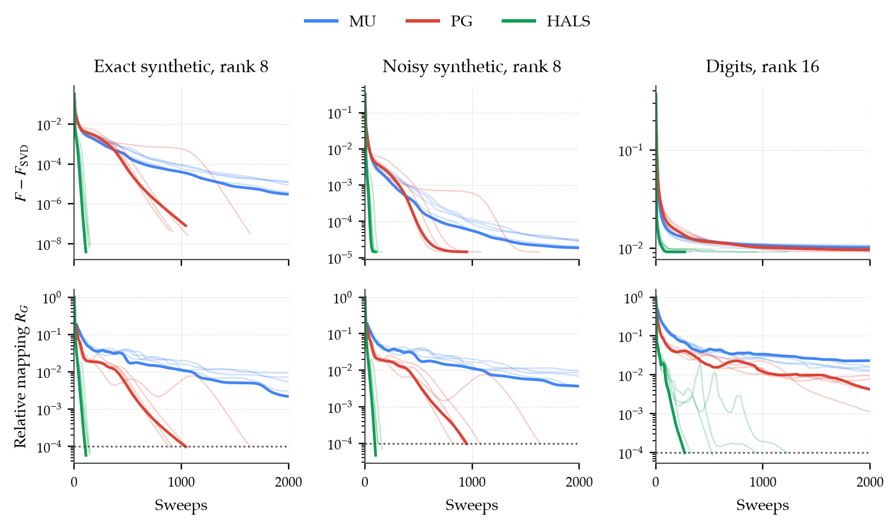

<div align="center">
<h1>COMP6704 Individual Assignment</h1>
<p><b>Nonconvex Optimization for Nonnegative Matrix Factorization</b><br/>
Multiplicative Updates · Alternating Projected Gradient · HALS</p>
<p><strong>English</strong> | <a href="README_zh-CN.md">中文</a></p>
<p>LIU Xuyang<br/>
COMP6704 · Advanced Topics in Optimization · 2026</p>
</div>

This repository compares three alternating solvers for nonnegative matrix
factorization under matched initializations. It includes the data, saved
histories, verification checks, and scripts used to generate the report's
figures and tables.

| Method | Implementation | Update |
| --- | --- | --- |
| Multiplicative updates, MU | `experiment.py:step_mu` | Elementwise multiplicative scaling |
| Projected gradient, PG | `experiment.py:step_pg` | One projected step per factor with a block Lipschitz constant |
| Hierarchical alternating least squares, HALS | `experiment.py:step_hals` | One exact row or column sweep per factor |

## Problem

For a nonnegative matrix $V$, minimize the normalized reconstruction loss

$$
\min_{W,H\geq0}\ F(W,H)=\frac{\|V-WH\|_F^2}{2\|V\|_F^2}.
$$

Fixing either factor gives a convex nonnegative least-squares subproblem.
The joint problem is nonconvex. Objective descent, first-order stationarity,
and global optimality are assessed separately.

## Quick start

The saved experiments use Python 3.14.5. Pinned dependencies are listed in
[`requirements.txt`](requirements.txt).

```bash
python3.14 -m venv .venv
source .venv/bin/activate
python -m pip install -r requirements.txt
python verify.py
python experiment.py
python analyze_results.py
python make_report_assets.py
```

`experiment.py` regenerates the main experiments and timings.
`analyze_results.py` reruns all 75 terminal points and checks their objectives,
residuals, sweep counts, and stopping status without replacing the saved main
results or timings. It writes `results/diagnostics.json`.

To regenerate figures and tables from the included results, run only:

```bash
python make_report_assets.py
```

Python, BLAS, and platform differences can affect floating-point results,
stopping iterations, and timing. The analysis uses explicit numerical
tolerances and requires matching sweep counts. An isolated archive smoke test
passed using existing dependencies; a fresh dependency installation has not
been tested.

## Experiments

| Setting | Matrix shape | Rank | Initializations |
| --- | --- | --- | --- |
| Exact synthetic | 80 × 500 | 8 | 5 |
| Noisy synthetic | 80 × 500 | 8 | 5 |
| Handwritten digits | 64 × 1,797 | 8, 16, 32 | 5 per rank |

The five settings and three methods produce 75 main runs. Additional checks
cover a zero-locking failure, independent SciPy NNLS subproblems, rank-one
recovery, finite differences, nonnegativity, descent, and zero-block handling.
Digit labels select illustrations only and do not enter optimization.



## Interpreting the results

The protocol normalizes nonzero columns of $W$ to unit Euclidean norm and
compensates in $H$ after each sweep. It checks the relative unit-step
gradient-mapping norm every ten sweeps, with tolerance $10^{-4}$ and a
2,000-sweep cap.

| Diagnostic at the original endpoints | MU | PG | HALS |
| --- | ---: | ---: | ---: |
| Runs meeting the threshold under unit-norm W columns | 0/25 | 11/25 | 25/25 |
| Same endpoints re-evaluated under unit-norm H rows | 0/25 | 2/25 | 7/25 |

The second row also transforms the initial factors before recomputing each
relative denominator. It is an endpoint sensitivity check, not a rerun using
an H-row stopping rule. These counts describe the stated protocol and budget.

The saved field `relative_pg` denotes a continuous unit-step gradient mapping,
not Lin's active-set projected-gradient norm. The PG implementation uses one
block step rather than Lin's line-search and inner-solve variants. HALS has no
extra inner sweeps or acceleration.

The SVD value is a lower bound after dropping nonnegativity. Library solutions
are additional feasible points, not global-optimality certificates.
Matched-objective targets are retrospective; the tables report reached counts
and medians conditional on reaching the target. Initialization ranges concern
fixed matrices rather than dataset sampling or numerical perturbations.

Each configuration has one short timing measurement in a fixed execution order.
Single-thread execution is requested before NumPy import and through
`threadpoolctl`; the effective Apple Accelerate thread count was not measured
independently. The timings do not establish a stable speed ranking.

## Repository layout

```text
experiment.py          Data generation, initialization, solvers, and main runs
verify.py              Numerical checks and independent NNLS comparisons
analyze_results.py     Endpoint checks and supplementary diagnostics
make_report_assets.py  Four figures, three tables, and numerical LaTeX macros
requirements.txt       Pinned numerical and plotting dependencies
data/                  Matrices and digit labels used in the experiments
results/               Raw histories, terminal values, metadata, and checks
figures/               PDF and PNG plots
tables/                Generated LaTeX tables and numerical macros
```

Machine-specific absolute library paths in public metadata are reduced to
filenames. Numerical results and timings are preserved. The accompanying
course archive additionally includes the report, its TeX source, and the
NeurIPS 2025 style file.

## References

- Lee and Seung. *Algorithms for Non-negative Matrix Factorization*.
  NeurIPS 2000.
- Cichocki, Zdunek, and Amari. *Hierarchical ALS Algorithms for Nonnegative
  Matrix and 3D Tensor Factorization*. ICA 2007.
- Lin. *Projected Gradient Methods for Nonnegative Matrix Factorization*.
  Neural Computation, 2007.
- Gillis and Glineur. *Accelerated Multiplicative Updates and Hierarchical
  ALS Algorithms for Nonnegative Matrix Factorization*. Neural Computation, 2012.
- Grippo and Sciandrone. *On the convergence of the block nonlinear
  Gauss-Seidel method under convex constraints*. Operations Research Letters, 2000.

The digits data is distributed with scikit-learn. Paper PDFs and internal
review material are not redistributed in this repository.
